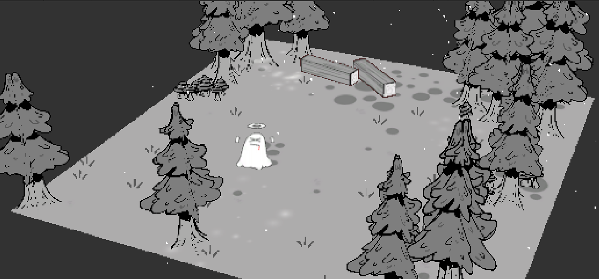
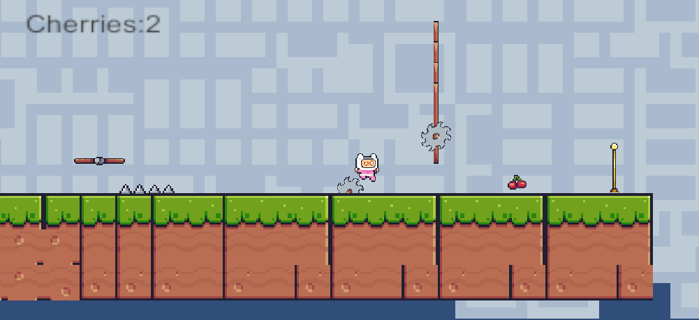

# Ghostlight Arcade

**一片有幽灵的森林，和一段收集樱桃的闯关旅程。**

我把上学期多媒体课程中做的两个小作品整理在了这里。一个用 2D 图片在 3D 空间里搭出森林场景，尝试镜头、动画和粒子效果；另一个是 2D 平台闯关游戏，把移动、跳跃、收集和关卡切换串成完整流程。制作时有跟随教程学习和复现的部分，这次也把保留下来的 Windows 成品和相关资料放在一起。

## Ghostlight Grove｜森林幽灵场景

这部分想做的是一个有纵深和氛围感的小场景。树木、地面、长椅等元素由不同层次的图片组成，放进 3D 空间后，利用前后距离形成空间感。镜头移动时，原本平面的素材也能呈现出层次变化。

场景里的小幽灵使用骨骼动画，部分精灵会朝向镜头；光点和薄雾由粒子效果补充。图片叠层负责环境结构，动画和粒子让画面动起来，镜头控制则把这些元素连接成可以观察的场景。

## Cherry Run｜樱桃平台闯关

这部分是一个可以收集樱桃的 2D 平台小游戏。玩家在平台间移动和跳跃，收集沿途的樱桃，避开陷阱，再到达终点进入下一关。成品包含开始页、两个关卡和结束页。

关卡通过 TileMap 搭建，角色动作由 Animator 控制，移动、跳跃、收集计数、死亡重试和场景切换由 C# 脚本配合 2D 物理碰撞实现。移动平台和陷阱让路线有了节奏，也把角色操作、碰撞判断和关卡流程联系起来。

两张预览图均来自当时的课程报告。

## 运行

成品使用团结引擎 **2022.3.62t6** 构建，运行平台为 **Windows x64**。

| 内容 | 成品目录 | 启动文件 |
| --- | --- | --- |
| 樱桃平台闯关 | [games/cherry-run/windows](games/cherry-run/windows) | `I am a man.exe` |
| 森林幽灵场景 | [games/ghostlight-grove/windows](games/ghostlight-grove/windows) | `scenesample.exe` |

可以克隆整个仓库，或通过页面上的 **Code → Download ZIP** 下载后解压，再进入对应目录运行。启动文件需要同级的 `TuanjiePlayer.dll`、`MonoBleedingEdge` 和对应的 `*_Data` 文件夹，请保留整个目录。

## 技术与资料

两个作品分别围绕 2D 游戏流程和 3D 场景表现展开，使用了 Sprite、TileMap、Animator、2D 物理碰撞、粒子系统、骨骼动画、镜头控制和 C# 脚本。具体实现线索整理在 [技术说明](docs/implementation-notes.md) 中。

原始工程中的 `Assets`、`Packages`、`ProjectSettings` 尚未找回。我从成品的 `Assembly-CSharp.dll` 中恢复了 [13 个 C# 脚本](src/recovered/README.md)，把角色控制、收集、死亡重试、平台、菜单和镜头逻辑一起保留下来，方便直接对照阅读。两组脚本分别通过了独立编译检查；恢复代码不包含场景、预制体和资源关联，还不能直接组成完整的编辑器工程。

其他资料也一起保留在仓库中：

- [测试用例](docs/test-cases.csv)：整理了移动跳跃、收集、陷阱、关卡切换、镜头和画面效果等 22 条用例，目前全部待执行。
- [核验记录](docs/test-report.md)：记录本次实际完成的检查及其范围。
- [成品文件校验清单](games/build-manifest.json)：记录两份成品的文件路径、大小和 SHA-256。
- [教程与素材来源](THIRD_PARTY.md)：记录现有的来源线索和仍需补充的信息。

教程、素材和字体来源仍在补充，仓库暂未设置覆盖整个作品的统一开源许可证。
