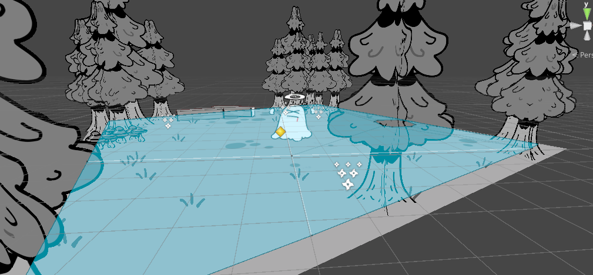
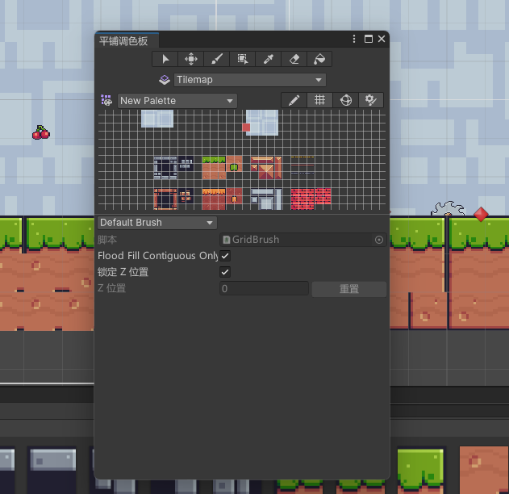
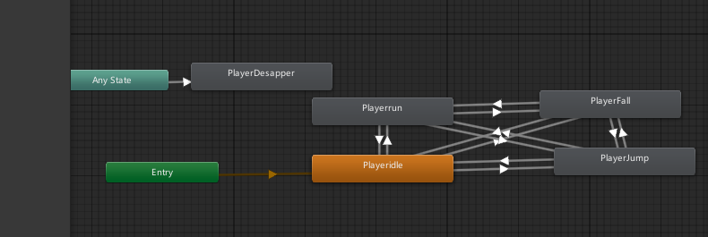
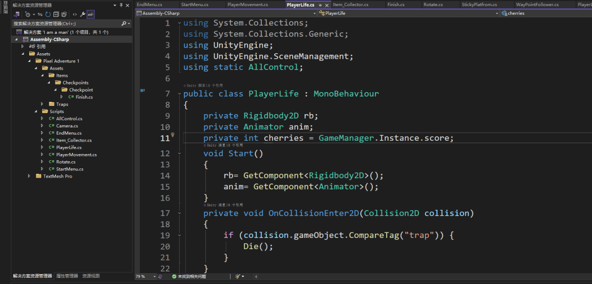

# 制作记录

这两个作品分别尝试了场景表现和小游戏流程。森林场景关注图片、空间和镜头之间的关系；樱桃闯关则把角色操作、碰撞、动画和关卡切换接在一起。这里把当时报告中留下的制作过程，以及成品中还能核对的实现线索整理下来。

## 用平面图片搭出森林

森林的基础是一个平面，地面材质提供纹理，再把树木、长椅、草地等元素放进场景。树木等物体通过图片叠放形成层次，简单物体需要的图片较少，复杂物体则增加不同方向和位置的图片。

图片仍然是平面的，但它们在空间里有不同的位置。镜头移动时，前后层的相对位置和遮挡关系也跟着变化，于是画面能够呈现出纵深。部分精灵通过朝向镜头的方式，减少从侧面观察时只剩一条薄片的情况。

小幽灵使用骨骼动画，让身体和肢体产生连续变化；光点和薄雾则由粒子系统补充。粒子的发射速率、颜色、生命周期会共同影响画面密度，调整时需要让效果看得出来，又不遮住场景主体。

3D 成品的自定义程序集中保留了 `CameraMovement` 和 `FacingCamera`。镜头相关字段包括距离、角度边界和阻尼，精灵朝向脚本则与场景中的子物体有关。具体行为可以结合恢复脚本查看；原场景里的挂载关系和序列化参数仍需要原工程才能完整核对。

## 把 2D 关卡画出来

关卡通过 Grid 和 TileMap 组织。把地面、平台和其他图块放进瓦片调色板，再在网格里绘制，就能让地形保持统一的尺寸和排列。

画出平台只是外观部分。角色能不能站上去、是否会穿过地形，还要由 2D 刚体、碰撞体及脚本一起决定；陷阱、收集物和终点也需要各自的碰撞或触发逻辑。

## 操作、物理和动画如何接起来

角色操作先改变移动和跳跃状态，物理组件负责位置与接触关系，Animator 再根据状态切换静止、跑动、跳跃、下落和死亡等动作。它们需要相互配合：只有动画而没有移动逻辑，角色会原地跑；只有位置变化而没有动画切换，角色看起来又会像在滑行。

原报告中保留了 `PlayerLife` 的代码画面，能够看到获取 `Rigidbody2D`、`Animator`，以及通过 `OnCollisionEnter2D` 判断 `trap` 标签后调用死亡逻辑的过程。

图片记录了当时的一部分写法，代码目录中的恢复脚本则来自现存游戏程序集；两者可以对照查看，但报告图片不能补回已经缺失的完整工程。

## 从收集到通关

游戏流程围绕“进入关卡—移动跳跃—收集樱桃与避开陷阱—到达终点”展开。成品中保留了开始页、第一关、第二关和结束页四个场景的记录。

| 模块 | 对应的实现内容 |
| --- | --- |
| 角色 | 输入、移动、跳跃、地面判断及动画切换。 |
| 收集 | 道具接触、道具消失、计数与 UI 更新。 |
| 陷阱 | 碰撞判断、死亡动画和重新进入关卡。 |
| 平台 | 沿路径移动，以及角色站上、离开平台时的关系。 |
| 场景 | 开始游戏、到达终点、切换关卡和重新开始。 |

这也是测试用例按模块拆分的依据。计分是否跨关保留、死亡后回到哪里、镜头边界如何限制等具体规则，需要结合脚本和实际运行分别核对。

## 保留下来的材料

- `games/` 保存 Windows 成品、运行库和打包资源，里面的 `Assembly-CSharp.dll` 是游戏逻辑编译后的程序集。
- `src/recovered/` 保存从这两份自定义程序集恢复的 C# 脚本，恢复范围和校验结果在代码目录内说明。
- 本页的四张制作图片来自原课程报告第 9、10、14、15 页，没有重新采集编辑器画面。
- 原始工程的场景、预制体、资源导入设置和脚本挂载关系尚未找回，因此恢复脚本本身还不能组成可直接打开的完整团结工程。
